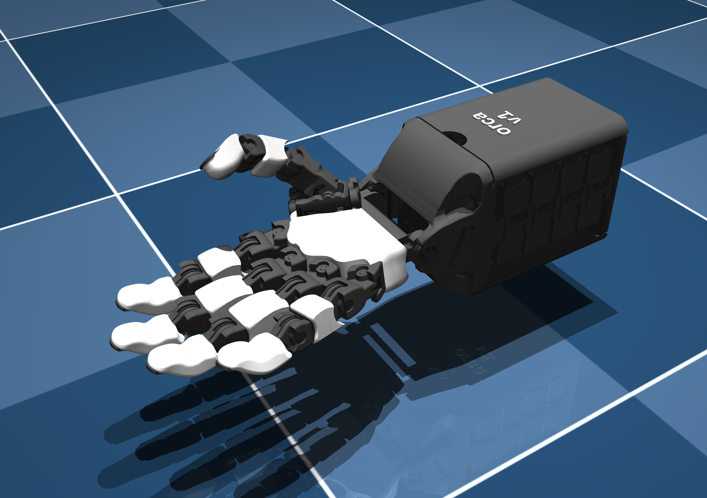
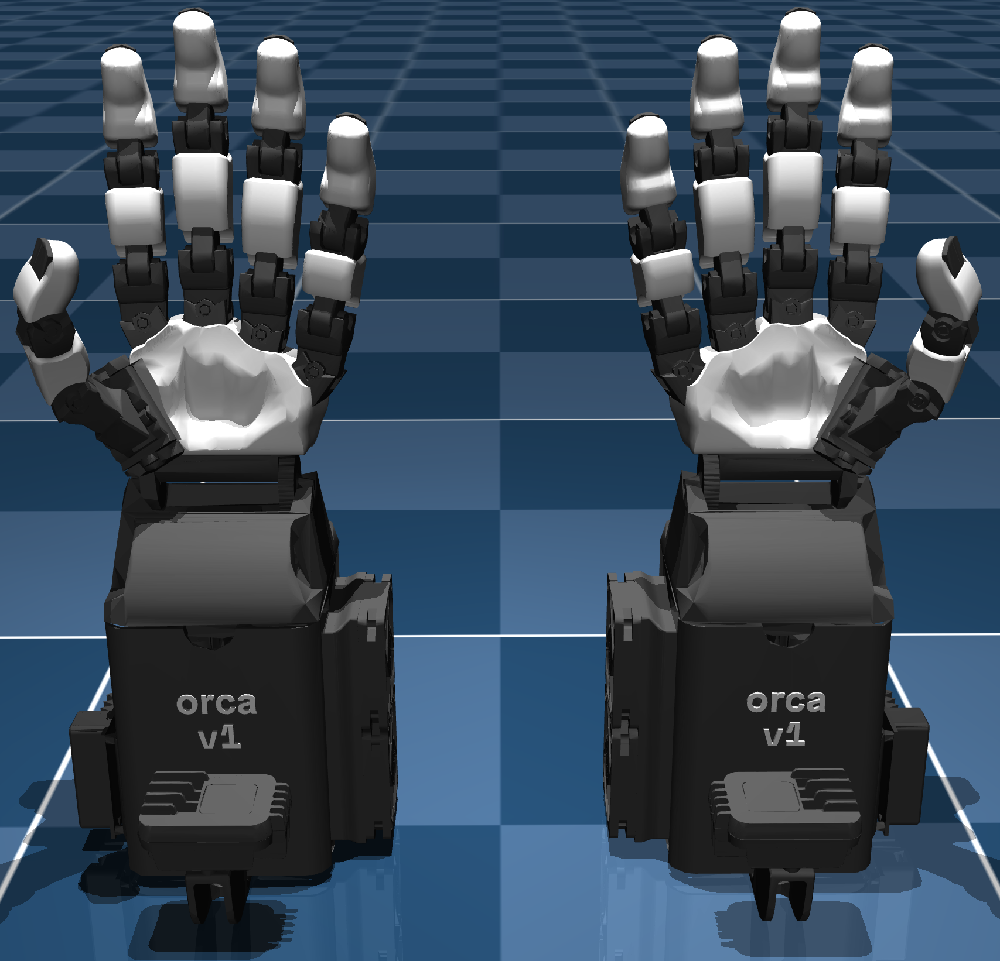

<div style="display: flex; gap: 10px;">
  
  
</div>

# Orcahand Description

This repository contains the description files for the Orcahand model (both URDF and MJCF).

Versioned model layouts live under:
- `v1/`: legacy hand description files, including the `extended` variants
- `v2/`: updated hand description files from the newer Fusion360 export

The `extended` version contains additional bodies (incl. inertial properties) such as the camera mount, the U2D2 board and fans.

## v2 Naming Convention

All v2 joint, link and body names are semantic and side-prefixed, matching orca_core's joint ids:

- Joints: `{side}_{joint}` with the 17 joints `wrist`, `thumb_cmc`, `thumb_abd`, `thumb_mcp`, `thumb_dip`, and `{finger}_abd` / `{finger}_mcp` / `{finger}_pip` for `index`, `middle`, `ring`, `pinky` (e.g. `right_index_mcp`). The URDF additionally has fixed joints: `{side}_tower_fixed` and the five `{side}_{finger}_fingertip_fixed` anchors.
- Links/bodies: `{side}_forearm`, `{side}_tower`, `{side}_carpals`, then per finger `{side}_{finger}_ap`, `{side}_{finger}_pp`, `{side}_{finger}_fingertip_assembly` (thumb: `thumb_tp`, `thumb_ap`, `thumb_pp`, `thumb_dp`). The MJCF body tree is rooted at a `{side}_base` attachment body; actuators are named `{joint}_actuator`.
- Fingertip anchors: each URDF additionally carries a massless `{side}_{finger}_fingertip` leaf link (fixed joint `..._fingertip_fixed`) marking the tip point on the fingertip skin surface, for retargeting and visualization.
- Mesh files and MJCF mesh asset names keep their Fusion360 part names (e.g. `R-Carpals.stl`).

The left hand is generated from the right by `utils/mirror_left_from_right.py` (verify with `--check`); left names are the right names with the side prefix swapped.

## Example Usage
1. Clone the repository:
   ```bash
   git clone git@github.com:orcahand/orcahand_description.git
   cd orcahand_description
   ```
2. Install the required visualization dependencies:
   ```bash
   pip install mujoco
   ```
3. Simulate any version using MuJoCo:
   ```bash
   python -m mujoco.viewer --mjcf=v1/scene_combined.xml
   python -m mujoco.viewer --mjcf=v2/scene_combined.xml
   ```

## Note on Meshes
Visual meshes contain the following amount of faces:
- Main tower, camera & fans: 15'000
- Rest of base: 2'000
- Skin: 5'000
- Rest: 500

Collision meshes contain the following amount of faces:
- Main tower, camera & fans: 7500
- Rest of base: 1000
- Skin: 500
- Rest: 250

You can further reduce or mirror meshes using the `utils/mesh_utils.py` script. With the same script, you can also print their number of faces. Some extra dependencies are required:
```bash
cd utils
pip install -r utils_requirements.txt
```

We can also recommend the VSCode extension `mtsmfm.vscode-stl-viewer` for quickly visualizing STL meshes.

## License

This project is licensed under the [MIT License](LICENSE).

## Contact

For questions or support, please contact the maintainers of this repo or the Orcahand team via our website ([https://orcahand.com](https://orcahand.com)).
